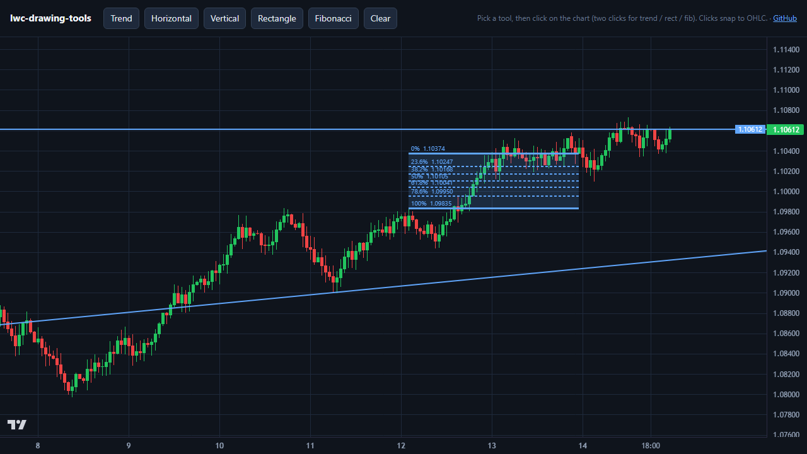

# lwc-drawing-tools

Drawing tools for [Lightweight Charts](https://github.com/tradingview/lightweight-charts): trend lines with right-extension rays, Fibonacci retracements, rectangles, horizontal and vertical lines, plus OHLC snapping, resize handles and drag-to-move.

Lightweight Charts ships without drawing tools. This is the layer I built for a production web trading terminal, pulled out as a small library with no runtime dependencies.

**[Live demo →](https://ivala2081.github.io/lwc-drawing-tools/example/)**

[](https://ivala2081.github.io/lwc-drawing-tools/example/)

[](https://github.com/ivala2081/lwc-drawing-tools/actions/workflows/test.yml)


## What's inside

| Module | What it does |
|---|---|
| `chartMath.js` | Hit-testing, ray extension, resize-handle geometry, Fibonacci levels, OHLC snap, time ↔ bar-index mapping |
| `drawers.js` | Canvas rendering for every tool, selection halo, pixel-snapped strokes, light/dark themes |
| `lwcAdapters.js` | Wraps a chart + series into a `{timeToX, priceToY, xToTime, yToPrice}` adapter, including a **continuous time axis** so drawings can sit between bars and in the future |
| `validation.js` | Candle hygiene: Hampel-filter spike clamping, outlier-tolerant price band, asset-class detection from the symbol |
| `react/` | `useMarkupTools` (tool state machine), `useChartMarkupOverlay` (canvas, pointer and keyboard wiring), `useMarkupStore` (in-memory or localStorage) |

The core is framework-free. The React hooks are optional. TypeScript definitions are included.

## Why it exists

A few problems you hit as soon as you draw on Lightweight Charts yourself:

- **Drawings can't live in the future.** `timeToCoordinate` returns `null` past the last bar and between bars, so a trend line can't be projected forward. `makeAdapter(chart, series, { bars, intervalMs })` maps time to a fractional bar index instead, so the axis is continuous and unbounded.
- **Fibonacci levels drift on log scale.** Interpolating levels in pixel space is right on a linear scale and wrong on a logarithmic one. Here every level is computed as a price first, then mapped to pixels.
- **What you see is not what you can grab.** The renderer and the hit-test share the same geometry functions (`rayEndpoints`, `markupHandlePoints`), so a visible ray is always clickable along its whole length.
- **Bad ticks wreck the scale.** One corrupt bar squashes the whole chart. `sanitizeCandles` clamps isolated spikes with a centered median filter but keeps real trends.
- **Backspace deletes your drawing while you type a lot size.** The overlay ignores keyboard shortcuts inside inputs and only listens while a tool is active.

## Install

Not on npm yet. Copy `src/` into your project, or install from GitHub:

```bash
npm install github:ivala2081/lwc-drawing-tools
```

Peer dependencies: `lightweight-charts` 4.x, and `react` ≥ 17 if you use the hooks.

## Quick start (no framework)

```js
import { createChart } from 'lightweight-charts';
import { makeAdapter, toLwcData, drawMarkups, DARK_THEME } from 'lwc-drawing-tools';

const chart = createChart(container, { autoSize: true });
const series = chart.addCandlestickSeries();
series.setData(toLwcData(candles));            // candles: [{ bucket(ms), open, high, low, close }]

const markups = [
  { id: '1', tool: 'trend', payload: { p1: { t, price }, p2: { t, price }, extendRight: true } },
  { id: '2', tool: 'fib',   payload: { p1: { t, price }, p2: { t, price } } },
];

// Draw on a transparent <canvas> stacked over the chart.
const adapter = makeAdapter(chart, series, { bars: candles.map(c => c.bucket), intervalMs: 3_600_000 });
const plot = { left: 0, top: 0, right: width - chart.priceScale('right').width(), bottom: height - chart.timeScale().height() };
drawMarkups(ctx, markups, adapter, plot, DARK_THEME);
```

[`example/index.html`](example/index.html) is a complete working page with click-to-draw.

## React

```jsx
import { useRef } from 'react';
import { useMarkupTools, useChartMarkupOverlay, useMarkupStore } from 'lwc-drawing-tools/react';
import { DARK_THEME } from 'lwc-drawing-tools';

function Chart({ symbol, timeframe }) {
  const chartRef = useRef(null), seriesRef = useRef(null);
  const hostRef = useRef(null), canvasRef = useRef(null);

  const tools = useMarkupTools();
  const store = useMarkupStore({ storageKey: `markups:${symbol}:${timeframe}` });
  const { canvasProps } = useChartMarkupOverlay({
    chartRef, seriesRef, hostRef, canvasRef, tools, persist: store, theme: DARK_THEME,
  });

  return (
    <div ref={hostRef} style={{ position: 'relative' }}>
      {/* mount the lightweight-charts chart here and fill chartRef / seriesRef */}
      <canvas ref={canvasRef} {...canvasProps} style={{ position: 'absolute', inset: 0 }} />
      <button onClick={() => tools.setActiveTool('trend')}>Trend</button>
    </div>
  );
}
```

To save drawings to your own backend, write a hook that returns the same shape as `useMarkupStore`: `{ markups, addMarkup, deleteMarkup, queueUpdate, clearAll }`.

## Markup format

```js
{ id, tool: 'trend' | 'horizontal' | 'vertical' | 'rect' | 'fib',
  payload: {
    p1: { t: <ms>, price }, p2?: { t: <ms>, price },
    color?, width?,          // per drawing
    extendRight?,            // trend: draw as a ray
    levels?,                 // fib: ratios, stored per drawing
  } }
```

Points are stored as real time and price, not pixels, so drawings survive zoom, pan, resize and reloads.

## Tests

```bash
npm test
```

27 tests on Node's built-in runner, no dev dependencies.

## License

MIT © Hamed Alavi
